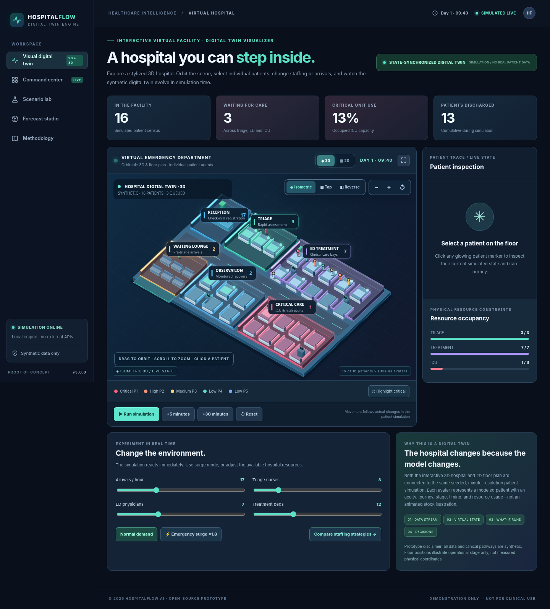
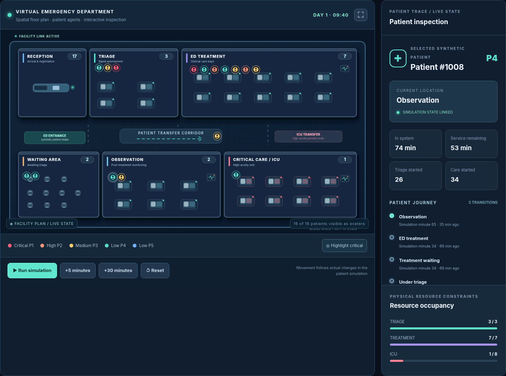
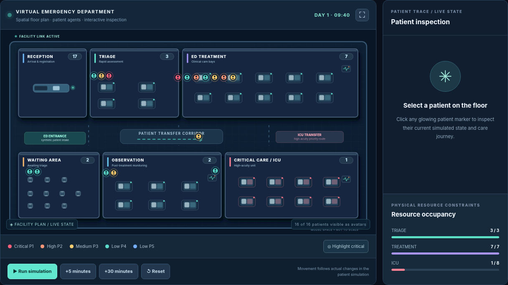
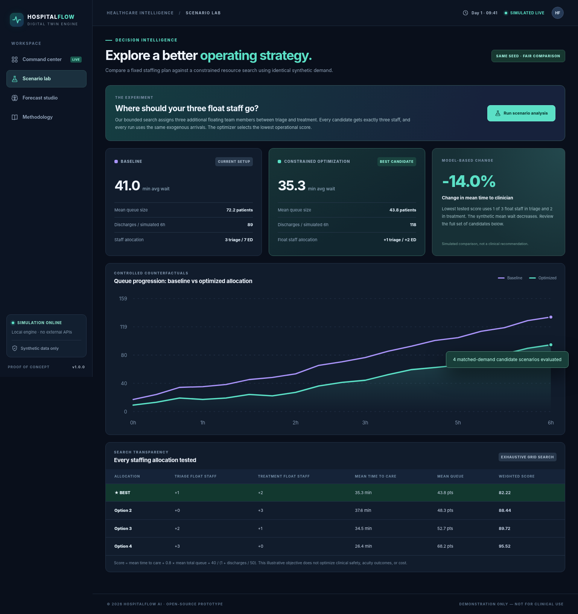
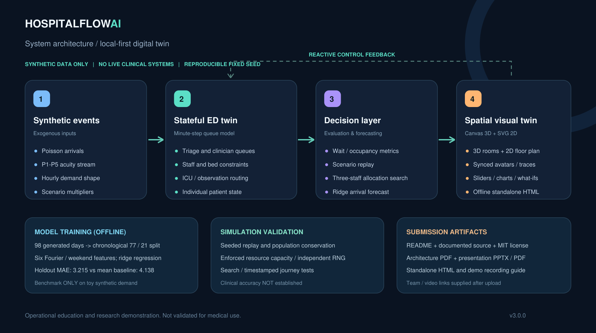

# HospitalFlow AI

### An Interactive 2D + 3D Hospital Digital Twin for Emergency Surge Simulation and Staffing Experiments

> **Status:** Functional, local-first hackathon proof of concept. **Not a medical device, not an actual live hospital connection, and not validated for clinical use.** All patient data, arrivals, outcomes and model training data in this repository are synthetic.



## Team and institution (fill these before submission)

| Field | Submission detail |
|---|---|
| **Project title** | HospitalFlow AI: Emergency Department Flow Digital Twin |
| **Team name** | `sai.manoj.260101103 (SynapseX)` |
| **Team members** | `Etcherla Sai Manoj` `Parameswara Meena Peddakotla` `Madhavaneni Vivek Rao` `Valivarthi Bhargava Varma` |
| **College / incubator** | `IIM Mumbai` |

## Problem statement

Emergency departments must coordinate patient arrivals, triage, clinician time, treatment beds and downstream care. Changing the volume or acuity of arrivals may create bottlenecks that simple dashboards only describe *after* they occur. HospitalFlow AI demonstrates how a virtual operating model can let decision-makers understand dynamic queues, explore surge conditions and compare hypothetical staffing policies before deploying them.

## Healthcare use case

A hospital operations coordinator wants to know: **If arrivals rise sharply, how will waiting queues, time to clinician, bed utilization and discharges change — and how should a fixed pool of three floating staff be allocated between triage and treatment?** The prototype can answer this question *within a synthetic queueing system*, and make the system state visible at every step. It makes no claim to predict an actual hospital without calibration.

## Working features

- **Stylized 3D Hospital Twin:** An offline-compatible, orbitable isometric scene with actual three-dimensional room geometry, beds, occupancy-linked bed highlights, interactive patient agents, camera presets and zoom. The renderer projects 3D world geometry onto HTML Canvas (it does not use WebGL or Three.js). Click an avatar to inspect its simulated care journey.
- **Interactive 2D Hospital Twin:** Toggle to the original spatial SVG floor plan with reception, triage, ED treatment, observation and ICU. Both views share the exact same patient identities, status and timestamps. Spatial positions represent modeled stages, **not** measured patient coordinates.
- **Live Command Center:** Simulated patient-level state, ED flow map, queues, mean arrival-to-treatment time, bed utilization, high-priority census and events.
- **Interactive intervention controls:** Change base arrival rate, switch to an ×1.8 demand surge, edit triage nurses, physicians and treatment beds *while the twin is running*.
- **Time controls:** Pause, play, reset and accelerate the synthetic event stream with a fixed reproducible seed.
- **Scenario Lab:** Compare current staffing with four allocations of a fixed three-person float pool over a six-hour simulation, after a 90-minute warm-up.
- **Bounded resource optimizer:** Exhaustively enumerates valid integer staff splits (0+3, 1+2, 2+1, 3+0), evaluates each against the same external arrival stream and ranks an **illustrative** operational score.
- **Forecast Studio:** Genuine ridge-regression model trained on generated synthetic hourly arrivals, with a disjoint chronological holdout and a constant-mean benchmark.
- **Export snapshot:** Save a JSON file of active configuration, synthetic state, history and comparison data.
- **Offline-ready:** No npm packages, remote APIs, cloud accounts or patient data required. A standalone HTML edition is included.

### Visual hospital overview




### Screenshots

| Visual hospital twin | Scenario lab |
|---|---|
|  |  |

## Run it (fastest)

**Option A — double-click:** Open `HospitalFlow-AI-Standalone.html` in a modern desktop browser. Everything (styles, code and the forecast model) is embedded. This is a *one-file deliverable*, ideal for a competition demonstration. **The 3D view is selected by default**; see [3D Quick Guide](docs/3D_QUICK_GUIDE.md) for orbit, zoom, click-inspection, and the 2D/3D toggle.

**Option B — modular source / GitHub Pages:** Open a terminal inside this repository and run (Node.js 18+; no Python needed):

```bash
npm start
```

An equivalent alternative is `python3 -m http.server 8000`, but Python is **not needed to run the digital twin**.

Visit **http://localhost:8000** and use `index.html`. Any static server works. For GitHub Pages, deploy the repository root; no build step is necessary. Opening `index.html` directly with a `file://` URL may fail because browsers restrict ES module imports — use Option A instead.

**Tests (Node.js 18+):**

```bash
node --test tests/*.test.js
```

**Retrain the synthetic forecast (Python 3 + NumPy):**

```bash
python3 scripts/train_forecaster.py
python3 scripts/build_standalone.py
```

## Architecture



[Architecture PDF](docs/ARCHITECTURE.pdf) — provided in the required PDF format.

1. A deterministic synthetic event generator introduces hourly-varying Poisson arrivals with acuity categories P1–P5.
2. The **stateful virtual ED** updates every simulated minute and applies staff and bed capacity constraints to triage, treatment and ICU services.
3. An analytics layer computes time to treatment, queues, occupancy, throughput and event history.
4. A what-if engine runs multiple instances under alternative staffing allocations; a ridge-regression component independently forecasts synthetic arrival rates.
5. A browser-native 3D scene and 2D spatial visualizer both render stage-linked individual patient agents, severity colors, stylized furniture and state-linked resource occupancy. Users can orbit, zoom and select patients to inspect their recorded journeys. The existing command center and scenario lab show complementary metrics and experiments.

The simulator uses separate pseudo-random streams for arrivals, patient acuity, service times and routing. Thus the arrival times and acuity categories remain identical between staffing allocations with the same seed; other stochastic outcomes can differ because processing order changes. This is a transparent fair-comparison improvement, not perfect pairing of every treatment outcome.

## Technical stack

| Layer | Technology |
|---|---|
| Web interface | HTML5, CSS3, dependency-free JavaScript ES modules |
| Interactive facility visualization | 3D-coordinate orthographic Canvas renderer, orbit/zoom camera; 2D SVG fallback; state-linked patient avatars, patient journey inspector |
| Charting and original flow map | Custom SVG (no charting/CDN dependencies) |
| Virtual system / event stream | Custom deterministic minute-step stochastic queueing simulator |
| Optimization | Exhaustive constrained integer allocation search (4 combinations) |
| AI/ML model | Fourier-feature ridge regression trained using Python and NumPy |
| Stored artifacts | JSON model, CSV generated training dataset, JSON user-exported simulation |
| Tests | Node.js built-in `node:test` |
| Deployment | Static hosting, local Node HTTP server, or self-contained offline HTML |

### AI/ML model details

- **Target:** synthetic hourly ED arrival count.
- **Training data:** 98 days × 24 hours (2,352 observations) generated from explicitly designed sinusoidal demand patterns and Poisson randomness. There are **no real patient records**.
- **Training split:** first 77 days (1,848 observations); last 21 days (504 observations) held out chronologically.
- **Features:** intercept, sine and cosine of 24-hour and 12-hour periods, weekend flag.
- **Algorithm:** ridge regression with unregularized intercept and fixed regularization for the five other features.
- **Evaluation (fixed seed, synthetic holdout):** MAE **3.215** patients/hour; constant-mean baseline MAE **4.138** patients/hour. These are reproducible *synthetic* results, **not hospital forecast accuracy**.
- **Inference:** `src/forecast.js` loads the learned coefficients from `data/forecast_model.json`, applies hourly Fourier features, and scales by the live dashboard scenario setting.
- **Resource allocation:** exhaustive constrained optimization; **not mislabeled as a deep neural network**. The score is mean time to clinician + 0.8 × mean queue + 40 / (1 + discharges / 50). This arbitrary demonstration scoring rule requires stakeholder redesign for production.

### Simulation assumptions

- Time resolution: 1 simulated minute.
- A synthetic arrival process creates patients; a separately seeded acuity draw assigns priorities P1–P5, where P1 is highest urgency.
- Patients enter triage queue; nurses restrict concurrent triage capacity. Priority order is lower P-number first, then earlier arrival.
- After triage, physician and treatment-bed capacity jointly restrict the number of patients in treatment.
- A simulated rule sends some patients to ICU, observation or discharge; ICU has its own capacity and patient queue.
- Service times and transitions use demonstrative pseudo-random intervals. They **do not represent calibrated treatment durations, medical risk or clinical prognosis**.
- Dashboard time to clinician is the mean from arrival to treatment start among patients who began treatment; it is not necessarily representative of people still waiting (survivorship/selection limitation).

## Evaluation and tests

See [`docs/VALIDATION.md`](docs/VALIDATION.md) for deterministic output examples, threats to validity and test coverage. Automated tests cover deterministic replay, population conservation, resource limits, matched arrival and acuity streams, surge sensitivity, valid resource allocations and numeric integrity.

## Required competition deliverables

| Submission item | Status / link |
|---|---|
| Public GitHub repository | **[ADD PUBLIC REPO URL AFTER UPLOAD]** |
| Team details | **[FILL TABLE ABOVE]** |
| College/incubator | **[FILL TABLE ABOVE]** |
| Project title | Included above |
| Problem statement | Included above |
| Healthcare use case | Included above |
| Technical stack | Included above |
| AI/ML model/framework | Included above |
| Demo video (15–20 min; YouTube Unlisted) | **[ADD ACTUAL UNLISTED YOUTUBE URL]** |
| Open-source license | [`LICENSE`](LICENSE) — MIT |
| Architecture PDF | [`docs/ARCHITECTURE.pdf`](docs/ARCHITECTURE.pdf) |
| Presentation PPTX/PDF | [`docs/PRESENTATION.pptx`](docs/PRESENTATION.pptx) / [`docs/PRESENTATION.pdf`](docs/PRESENTATION.pdf) |
| Public access for all files/links | **[CHECK AFTER UPLOAD]** |

**Important:** The form specifically mandates a **15–20-minute unlisted YouTube video**. A shorter video does not satisfy that stated requirement unless the organizers grant an exception. Follow the [`Demo script`](docs/DEMO_SCRIPT.md) if helpful.

## Repository map

```text
HospitalFlow-AI/
├── index.html                         Modular browser entry point
├── styles.css                         Responsive UI
├── HospitalFlow-AI-Standalone.html    Double-click offline build
├── src/
│   ├── twin3d.js                     3D geometry renderer, orbit camera, state-linked agents
│   ├── simulator.js                   Patient queue & resource engine
│   ├── optimizer.js                   Controlled scenario evaluation
│   ├── forecast.js                    ML inference
│   ├── charts.js                      SVG charts and original ED flow map
│   ├── twinView.js                    2D SVG hospital / patient agent renderer
│   └── main.js                        App state and interactions
├── data/
│   ├── forecast_model.json            Fitted synthetic ridge model
│   └── synthetic_hourly_arrivals.csv  Generated training/test records
├── scripts/
│   ├── server.cjs                     Optional Node.js local web server
│   ├── train_forecaster.py            Reproducible ML training
│   └── build_standalone.py            Dependency-free one-file build
├── tests/                             Automated reproducibility tests
├── docs/                              Architecture, pitch, screenshots & scripts
└── LICENSE                            MIT
```

## Limitations & future work

This is an **educational synthetic twin**. The 3D scene is a stylized interactive visualization projected by a self-contained Canvas renderer, not a photorealistic or tracked real hospital. It cannot recommend real patient triage, staffing levels, ICU admission, resource safety margins or clinical actions. Production deployment requires actual permissioned hospital operations data, event-time calibration, fairness/acuity analysis, external validation, security, privacy, clinical governance and prospective intervention studies. A real digital twin would connect to compliant operational systems with observed state feedback; this PoC uses simulated event replay to demonstrate that pattern without pretending to have live connections. **Both visualizations illustrate process stage, not actual indoor tracking:** avatar positions are deliberately stylized. A bed highlight depicts the number of simulated occupants up to the number of physical props shown, while numeric room indicators show all active counts; the visible bed props are illustrative and are not a complete representation of configurable capacity.

## License

MIT. See [LICENSE](LICENSE). © 2026 HospitalFlow AI contributors.
